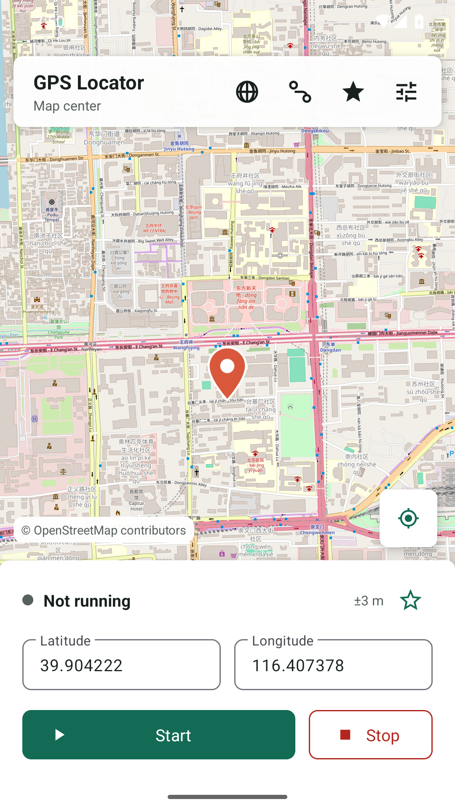
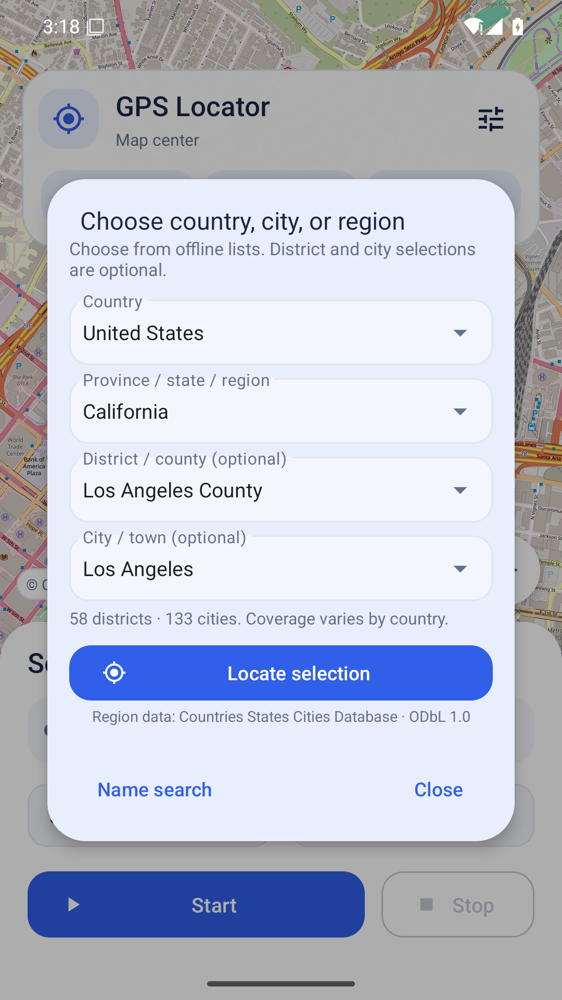
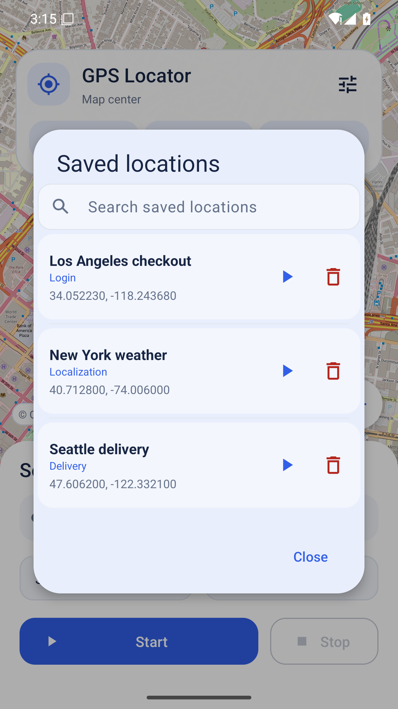
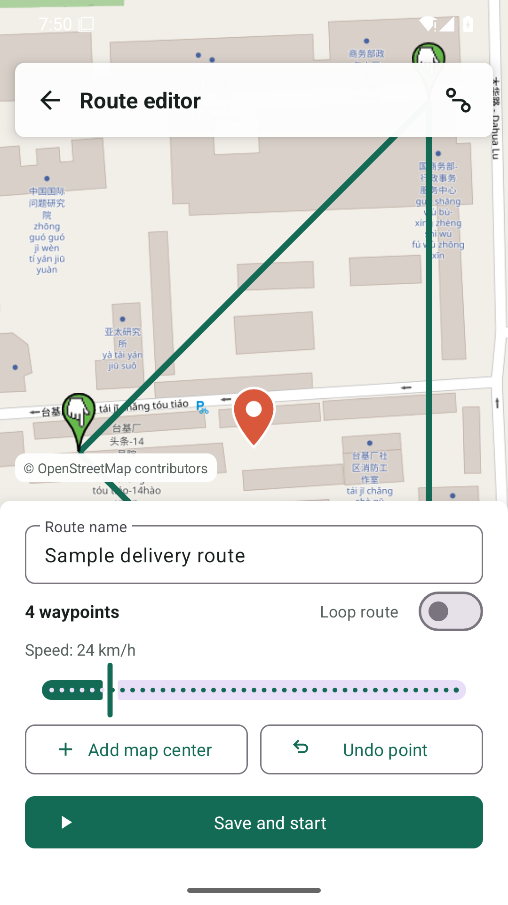

# GPS Locator

[](LICENSE)
[](https://github.com/0xfnzero/gps-locator/releases)
[](https://github.com/0xfnzero/gps-locator/releases)
[](app/build.gradle.kts)
[](https://kotlinlang.org/)

Open-source **Android mock location** / **fake GPS** app for developers and QA.

Set a point on the map, search 200+ countries, replay **GPX/KML** routes, back up data with end-to-end encryption, and drive a device fleet over **ADB**. No ads, no in-app purchases, no paid unlocks.

[中文说明](README.zh-CN.md) · [Download APK](https://github.com/0xfnzero/gps-locator/releases/latest) · [Contributing](CONTRIBUTING.md)

<p align="center">
  
</p>

<p align="center">
  
  
  
  
</p>

## Features

- **Mock GPS on Android 8+** without root: tap the OpenStreetMap map, drag, zoom, or type WGS84 coordinates
- **Region search** by country, city, and district across 200+ countries and regions
- **Saved locations** with groups, search, history, and meter-level joystick
- **Route simulation** with speed, waypoint stops, loops, and a sample route
- **GPX and KML** import/export, plus JSON team templates for sharing locations and routes
- **Encrypted sync** for optional self-hosted backups (AES-256-GCM on device)
- **ADB lab CLI** and a localhost control center for multi-device QA, time zones, and JSON/JUnit reports
- **Languages:** follow system, Simplified Chinese, English, Japanese, Spanish

Use it to test maps, logistics, weather, localization, and other location-aware apps on devices you are authorized to test. GPS Locator does **not** hide Android’s mock-location flag or bypass another app’s security checks.

## Install

1. Download [`gps-locator-2.0.0.apk`](https://github.com/0xfnzero/gps-locator/releases/download/v2.0.0/gps-locator-2.0.0.apk) from [Releases](https://github.com/0xfnzero/gps-locator/releases).
2. On the phone or emulator, enable **Developer options**.
3. Open **Select mock location app** and choose **GPS Locator**.
4. Allow location and notification permissions, then tap **Start**.

If the app is missing from the mock-location list, install 2.0.0 or newer, launch it once, then leave and re-enter Developer options.

The GitHub APK is signed with the Android debug key so it can be installed locally. A Play Store upload should use your own production keystore.

## Build from source

Needs Android Studio Ladybug or newer, **JDK 17**, and Android SDK 35.

```bash
./gradlew assembleRelease
```

APK output: `app/build/outputs/apk/release/app-release.apk`.

```bash
./gradlew testDebugUnitTest lintDebug
(cd desktop-cli && npm test)
(cd cloud-server && npm test)
```

## Repository layout

| Path | Description |
| --- | --- |
| [`app/`](app/) | Android mock location / fake GPS application |
| [`desktop-cli/`](desktop-cli/README.md) | ADB CLI, local web control center, scenario suites, reports |
| [`cloud-server/`](cloud-server/README.md) | Self-hosted encrypted backup server and Caddy HTTPS pack |
| [`store-listing/`](store-listing/README.md) | Optional Play Store copy, screenshots, and validators |
| [`docs/PRIVACY_POLICY.md`](docs/PRIVACY_POLICY.md) | Privacy policy template |

Map tiles default to public OpenStreetMap / Nominatim. For heavier traffic, point the build at your own endpoints:

```bash
GPS_TILE_URL_TEMPLATE='https://tiles.example.com/{z}/{x}/{y}.png' \
GPS_GEOCODING_BASE_URL='https://geocode.example.com' \
GPS_MAP_ATTRIBUTION='© Your map provider' \
GPS_PRIVACY_POLICY_URL='https://example.com/privacy/gps-locator' \
GPS_SUPPORT_EMAIL='support@example.com' \
./gradlew assembleRelease
```

## FAQ

**Does this hide mock location from other apps?**  
No. Android still reports a mock provider. Banking, payment, ride-hailing, and game apps may reject it.

**Do I need root or a Google Play purchase?**  
No. All features are included. ADB control needs a privileged `adb` / `DUMP` shell, not a paid license.

**Which coordinate system is used?**  
WGS84, matching Android Location APIs and OpenStreetMap. Some mainland China maps use GCJ-02 and can show an offset of a few hundred meters.

## Contributing

Bug reports and pull requests are welcome. See [CONTRIBUTING.md](CONTRIBUTING.md). Please do not reintroduce ads, billing, or paid feature gates.

## License

[MIT](LICENSE)
