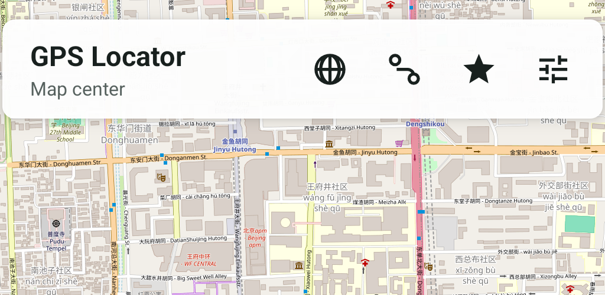
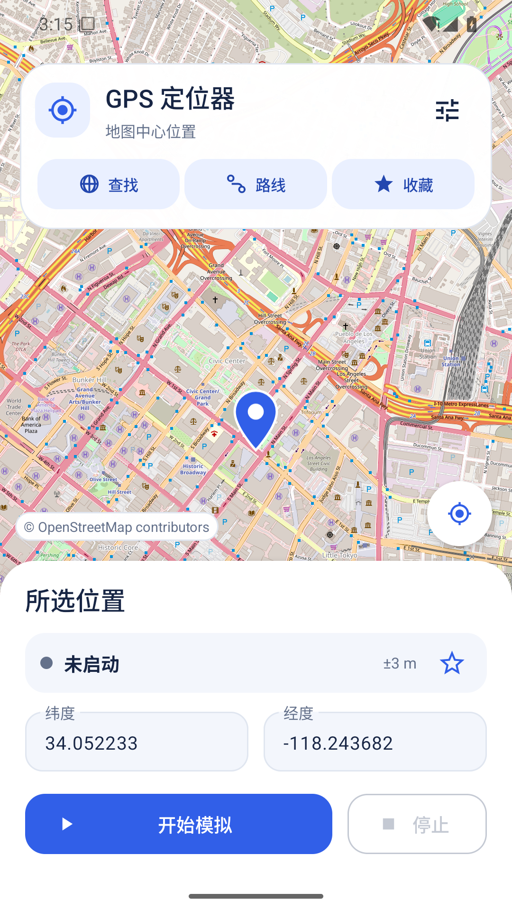
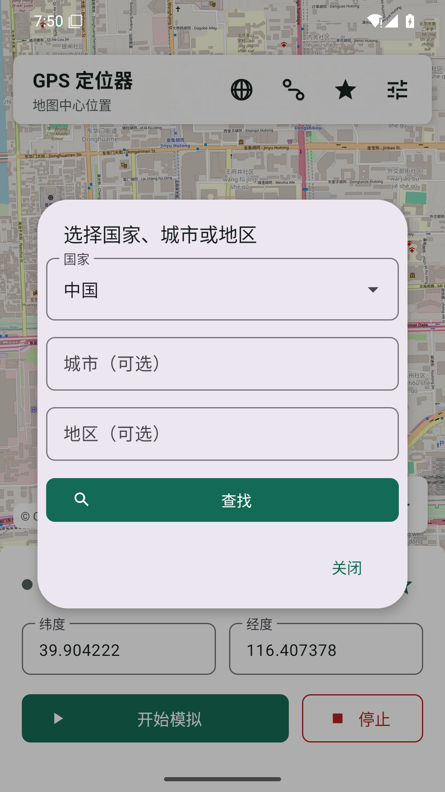
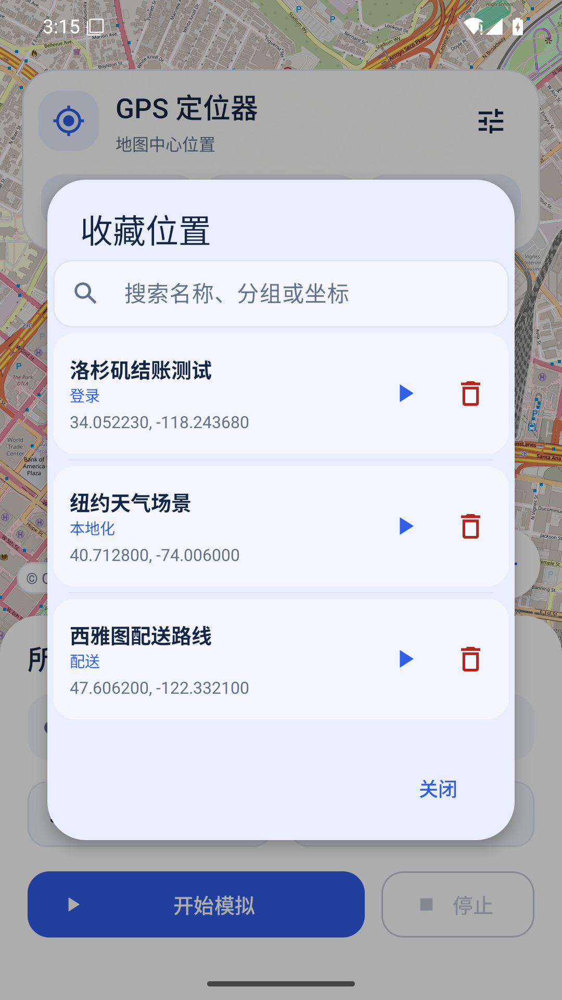
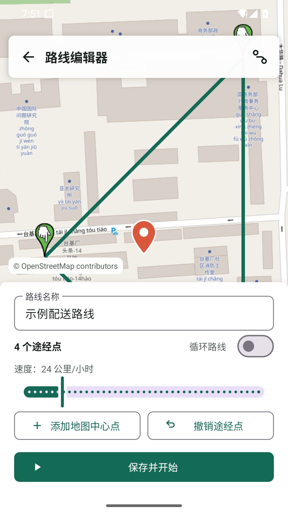

<div align="center">
  <h1>📍 GPS Locator</h1>
  <h3><em>开源 Android 模拟位置与路线仿真工具</em></h3>
</div>

<p align="center">
  <strong>在地图上选点、检索 200 多个国家和地区、回放 GPX/KML 路线、端到端加密备份，以及通过 ADB 控制多台设备。面向开发和 QA，无广告、无内购、无付费解锁。</strong>
</p>

<p align="center">
  <a href="https://github.com/0xfnzero/gps-locator/releases"></a>
  <a href="https://github.com/0xfnzero/gps-locator/releases"></a>
  <a href="https://github.com/0xfnzero/gps-locator/blob/main/LICENSE"></a>
  <a href="https://github.com/0xfnzero/gps-locator"></a>
  <a href="https://github.com/0xfnzero/gps-locator/network"></a>
</p>

<p align="center">
  
  
  
</p>

<p align="center">
    <a href="https://github.com/0xfnzero/gps-locator/blob/main/README.zh-CN.md">中文</a> |
    <a href="https://github.com/0xfnzero/gps-locator/blob/main/README.md">English</a> |
    <a href="https://fnzero.dev/">Website</a> |
    <a href="https://t.me/fnzero_group">Telegram</a> |
    <a href="https://discord.gg/vuazbGkqQE">Discord</a>
</p>

<p align="center">
  
</p>

<p align="center">
  
  
  
  
</p>

## Android 模拟位置功能

原生 Android 界面基于 [Material 3](https://m3.material.io/)，采用统一组件样式、地图主视图、带文字的快捷入口，以及圆角位置与路线控制面板。

- **Android 8+ 模拟 GPS**，无需 Root：OpenStreetMap 点击、拖动、缩放或输入 WGS84 坐标
- **地区检索**：国家、城市、地区，覆盖 200 多个国家和地区
- **收藏位置**：分组、搜索、历史、米级摇杆微调
- **路线模拟**：速度、途经点停留、循环，以及示例路线
- **GPX / KML** 导入导出，以及用于共享收藏和路线的团队模板
- **加密同步**：可选的自建备份（设备端 AES-256-GCM）
- **ADB 实验室 CLI** 和本机控制台：多设备 QA、时区、JSON/JUnit 报告
- **语言**：跟随系统、简体中文、English、日本語、Español

请只在自己有权测试的设备和应用中使用。本工具**不会**隐藏 Android 的模拟位置状态，也不会绕过其他应用的安全检查。部分银行、支付、出行和游戏 App 会拒绝模拟位置。

离线地区选择支持「国家 → 省／州 → 区县（可跳过）→ 城市／城镇」，直接点选定位，也可筛选列表名称。内置 250 个国家和地区、15 万多个城市／城镇；区县数据覆盖其中 26 个国家，未覆盖地点可通过独立的地名搜索入口查找。坐标为区域代表点，不是门牌地址。数据改编自 [Countries States Cities Database](https://github.com/dr5hn/countries-states-cities-database)，单独遵循 [ODbL 1.0](app/src/main/assets/regions/LICENSE-ODbL.txt)，应用代码仍使用 MIT 许可证。详见[数据来源与重新生成方式](app/src/main/assets/regions/README.md)。

## 安装 APK

1. 从 [Releases](https://github.com/0xfnzero/gps-locator/releases) 下载 [`gps-locator-2.1.0.apk`](https://github.com/0xfnzero/gps-locator/releases/download/v2.1.0/gps-locator-2.1.0.apk)。
2. 在真机或模拟器中打开**开发者选项**。
3. 在「选择模拟位置信息应用」中选择 **GPS 定位器**。
4. 允许位置和通知权限，然后点击「开始」。

如果列表里没有本应用，请安装 2.1.0 或更新版本，先启动一次 App，再退出并重新进入开发者选项。

GitHub 提供的 APK 使用 Android debug 签名，便于本机安装。上架 Play 时请使用你自己的生产密钥。

## 从源码构建

需要 Android Studio Ladybug 或更新版本、**JDK 17**、Android SDK 35。

```bash
./gradlew assembleRelease
```

产物路径：`app/build/outputs/apk/release/app-release.apk`。

```bash
./gradlew testDebugUnitTest lintDebug
(cd desktop-cli && npm test)
(cd cloud-server && npm test)
```

## 仓库结构

| 路径 | 说明 |
| --- | --- |
| [`app/`](app/) | Android 模拟位置应用 |
| [`desktop-cli/`](desktop-cli/README.md) | ADB 命令行、本机控制台、场景套件和报告 |
| [`cloud-server/`](cloud-server/README.md) | 自建加密备份服务与 Caddy HTTPS 部署包 |
| [`store-listing/`](store-listing/README.md) | 可选的 Play 文案、截图和校验工具 |
| [`docs/PRIVACY_POLICY.md`](docs/PRIVACY_POLICY.md) | 隐私政策模板 |

地图默认使用公共 OpenStreetMap / Nominatim。访问量大时请改为自建瓦片和地理编码服务：

```bash
GPS_TILE_URL_TEMPLATE='https://tiles.example.com/{z}/{x}/{y}.png' \
GPS_GEOCODING_BASE_URL='https://geocode.example.com' \
GPS_MAP_ATTRIBUTION='© Your map provider' \
GPS_PRIVACY_POLICY_URL='https://example.com/privacy/gps-locator' \
GPS_SUPPORT_EMAIL='support@example.com' \
./gradlew assembleRelease
```

## 常见问题

**会不会对其他 App 隐藏模拟位置？**  
不会。Android 仍会报告 mock provider。银行、支付、出行和游戏应用可能直接拒绝。

**需要 Root 或付费吗？**  
不需要。全部功能开源免费。ADB 控制需要有权限的 `adb` / `DUMP` shell，不需要付费许可证。

**坐标系是什么？**  
WGS84，与 Android Location API 和 OpenStreetMap 一致。中国大陆部分商业地图使用 GCJ-02，对照时可能有数百米偏移。

## 参与贡献

欢迎提交 issue 和 pull request，详见 [CONTRIBUTING.md](CONTRIBUTING.md)。请不要重新加入广告、内购或付费功能门槛。

## 许可证

[MIT](LICENSE)
